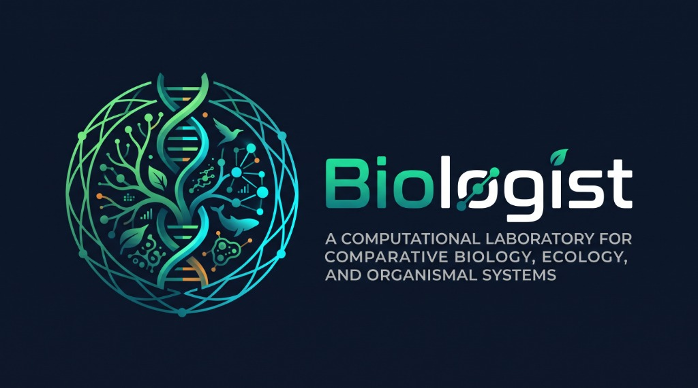
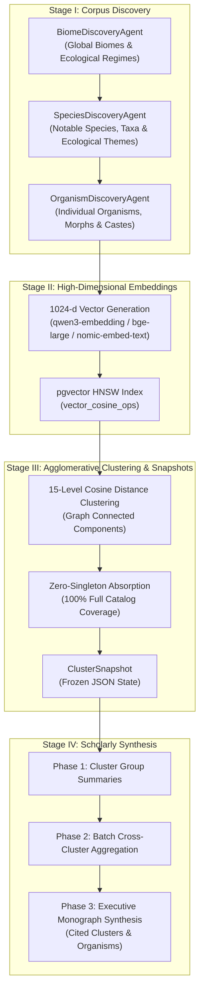
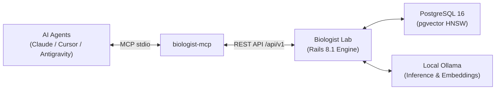

<p align="center">
  
</p>

# Biologist: A Computational Laboratory for Comparative Biology, Ecology, and Organismal Systems

[](https://www.ruby-lang.org/)
[](https://rubyonrails.org)
[](https://www.postgresql.org/)
[](https://github.com/pgvector/pgvector)
[](https://ollama.com)
[](https://github.com/flavorjones/ruby-llm)
[](https://sidekiq.org)
[](https://tailwindcss.com)
[](https://hotwired.dev)
[](https://github.com/leouofa/biologist-mcp)
[](LICENSE)

**Biologist** is an open-source computational research platform and quantitative analytical laboratory designed for **evolutionary biologists**, **ecologists**, **ethologists**, and **organismal taxonomists**. It enables researchers to systematically map, cluster, and synthesize ecological archetypes, convergent functional adaptations, trophic strategies, and phenotypic manifolds across biomes, species/populations, and individual organisms using **1024-dimensional semantic vector embeddings (`pgvector`)**, **graph-theoretic connected components**, and **multi-stage AI synthesis pipelines**.

Pair it with the official **[Biologist MCP Server](https://github.com/leouofa/biologist-mcp)** to connect AI agents (Claude Desktop, Claude Code, Cursor, Gemini CLI, Antigravity) directly to your computational laboratory.

---

## Abstract & Scholarly Vision

The biosphere spans an enormous diversity of living systems: from equatorial rainforests and boreal taigas to deep-sea hydrothermal vents and arid deserts; across taxonomic domains, clades, and populations; down to specialized morphological castes, life-history stages, and sexual dimorphisms. How can biologists discover systemic archetypal convergences, functional guilds, and ecological trade-offs across disparate biomes without losing the concrete organismal and phenotypic attributes of each entity?

Biologist operationalizes comparative biology and evolutionary ecology within a transparent, reproducible, locally hosted computational laboratory:

1. **Multi-Tier Ecological Architecture**:
   - **Biomes (`Biome`)**: Global ecosystems, climatic zones, and primary environmental regimes (e.g., Tropical Rainforest, Boreal Forest, Hot & Arid Desert, Arctic Tundra, Pelagic Open Ocean, Hydrothermal Vents).
   - **Species & Populations (`Species`)**: Canonical biological species, distinct geographic populations, or keystone taxa (`belongs_to :biome`).
   - **Individual Organisms (`Organism`)**: Distinct morphological castes, life-history stages, sexual dimorphic morphs, or notable organismal phenotypes (`belongs_to :species`).
2. **High-Dimensional Semantic Manifold**: Every species and organism profile is projected into a **1024-dimensional vector space** indexed via PostgreSQL `pgvector` HNSW (`vector_cosine_ops`), enabling empirical measurement of functional and phenotypic proximity.
3. **Multi-Granularity Empirical Clustering & Snapshotting**: Researchers interactively tune cosine distance thresholds across **15 granularity levels** (from tight functional analogs at *Level 1, $\le 0.16$* to zero-singleton **100% Full Catalog Coverage** at *Level 15* via nearest-cluster singleton absorption) and freeze states into immutable **Cluster Snapshots**.
4. **Map-Reduce & Hierarchical Deep Synthesis Reports**: Rather than shallow single-prompt summaries, Biologist executes a **2-Phase Map-Reduce** or **3-Phase Hierarchical Deep Synthesis** workflow over saved snapshots, inspecting every cluster through the researcher's specific biological inquiry and grounding every finding in cited cluster numbers, species, and individual organisms.

---

## 3-Tier Domain Mapping

| Tier | Domain Entity | Database Model | Table Name | Key Associations |
|------|---------------|----------------|------------|------------------|
| **Tier 1** | Biomes | `Biome` | `biomes` | `has_many :species`, `has_many :organisms, through: :species` |
| **Tier 2** | Species & Populations | `Species` | `species` | `belongs_to :biome`, `has_many :organisms`, `embeddable` |
| **Tier 3** | Individual Organisms | `Organism` | `organisms` | `belongs_to :species`, `has_one :biome, through: :species`, `embeddable` |

---

## End-to-End Empirical Research Pipeline



---

## Installation & Local Laboratory Setup

> [!TIP]
> **Prefer running with Docker?** You can run the entire development stack (Rails on port 3005, Sidekiq, Tailwind watcher, Redis, and PostgreSQL with pgvector) in Docker Compose:
> ```sh
> docker compose up -d --build
> ```
> See [docs/DOCKER.md](docs/DOCKER.md) for full details, Tailscale access, volume persistence, and everyday commands.

### Prerequisites

- **Ruby 3.4+**
- **PostgreSQL 16+** with `pgvector` extension installed (`CREATE EXTENSION IF NOT EXISTS vector;`)
- **Ollama** running locally on `http://localhost:11434` with an LLM and embedding model (e.g. `qwen2.5:32b`, `qwen3-embedding:0.6b` / `bge-large`)
- **Redis** running locally (for background job processing via Sidekiq)

### Setup

```bash
# Clone the repository
git clone https://github.com/leouofa/biologist.git
cd biologist

# Install dependencies
bundle install

# Prepare database (creates biologist_development and biologist_test, runs migrations)
bin/rails db:prepare

# Run test suite
bundle exec rails test

# Start the local development server (web + background worker)
bin/dev
```

Visit `http://localhost:3000` to access the interactive web interface.

---

## Programmatic REST API (`/api/v1`) & OpenAPI 3.1 Spec

Biologist provides a full-featured REST API under `/api/v1` returning JSON responses adhering to the `{ "data": ... }` envelope standard.

- Interactive OpenAPI 3.1 schema: `GET /api/v1/openapi.json`
- Full API documentation: see [docs/api.md](file:///Users/leonid/src/biologist/docs/api.md)

### Key Endpoints

- `GET /api/v1/biomes`: List biomes
- `GET /api/v1/species`: List species with optional filtering by `biome_id`, `theme`, or `q`
- `GET /api/v1/species/:id/neighbors`: Find nearest cosine-distance species neighbors
- `GET /api/v1/organisms`: List individual organisms with pagination
- `GET /api/v1/organisms/:id/neighbors`: Find nearest organism counterparts
- `GET /api/v1/clusters?target_type=Species&level=5`: Interactive agglomerative clustering
- `POST /api/v1/clusters/snapshot`: Freeze an empirical cluster snapshot
- `POST /api/v1/cluster_reports`: Synthesize an AI-grounded Map-Reduce or Deep Synthesis report

---

## Official Model Context Protocol (MCP) Server

Connect AI coding agents, IDEs, and assistant workflows (such as Claude Desktop, Claude Code, Cursor, Gemini CLI, and Antigravity) directly to Biologist via the official companion MCP server:

👉 **[Biologist MCP Server (`biologist-mcp`)](https://github.com/leouofa/biologist-mcp)**



The MCP server provides:
- **51 Registered Tools**: Cross-catalog hybrid semantic search, nearest counterpart discovery, full CRUD and discovery triggers for biomes, species, and organisms, 15-level agglomerative clustering, cluster snapshot freezing, and multi-stage Map-Reduce / Deep Synthesis report generation.
- **4 Registered Resources**: Read-only access to live platform status (`biologist://status`), biome catalogs (`biologist://biomes`), cluster snapshots (`biologist://snapshots/{id}`), and generated monographs (`biologist://reports/{id}`).
- **3 Prompt Templates**: Guided workflows for comparative biological analysis (`comparative_biological_analysis`), cluster snapshot monographs (`biological_cluster_monograph`), and evolutionary convergence inquiries (`evolutionary_convergence_inquiry`).

### Quick Setup

Add to your MCP client configuration (e.g., `claude_desktop_config.json`, Cursor, or Antigravity MCP settings):

```json
{
  "mcpServers": {
    "biologist": {
      "command": "node",
      "args": ["/path/to/biologist-mcp/dist/index.js"],
      "env": {
        "BIOLOGIST_API_BASE_URL": "http://localhost:3000/api/v1"
      }
    }
  }
}
```

For installation and local development instructions, see the **[biologist-mcp repository](https://github.com/leouofa/biologist-mcp)**.

---

## Open Science, Reproducibility, & Testing

Biologist is designed for open, reproducible science:

- **100% Local Inference**: Zero proprietary API lock-in.
- **Deterministic Clustering**: Snapshot algorithms freeze graph-theoretic components alongside exact centroid distances.
- **Comprehensive Test Suite**: Model tests, agent tests, job tests, service tests, and API controller tests with 100% passing coverage:

```bash
bundle exec rails test
```

---

## License

This project is open-source software licensed under the [MIT License](LICENSE).
